# Resilient Commerce Platform

### Highly Available Container Infrastructure & Automated CI/CD on AWS

## 1. Project Overview

The Resilient Commerce Platform is a cloud-native e-commerce infrastructure project built on Amazon Web Services (AWS).

It demonstrates how to design, deploy and operate a highly available containerized application capable of handling unpredictable traffic, asynchronous workloads and infrastructure failures.

The platform uses Amazon ECS Fargate to run independently scalable web and background worker services, Amazon SQS for asynchronous processing, RDS PostgreSQL for persistent storage and Redis for caching.

Infrastructure deployment and application delivery are automated using AWS CDK, CodePipeline and CodeBuild.

## 2. Architecture

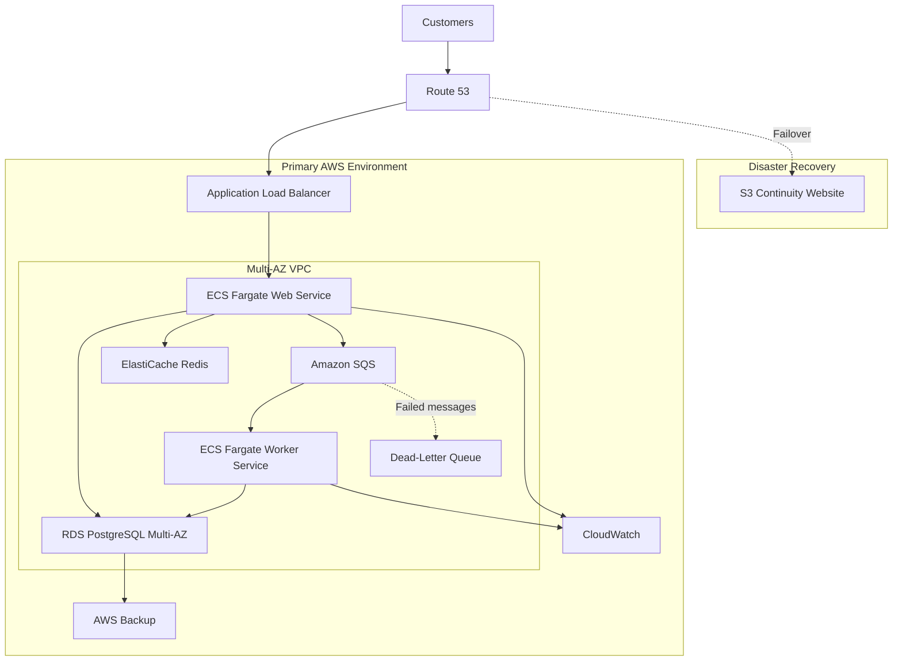

### Architecture Components

| Component | AWS Service | Purpose |
|---|---|---|
| DNS | Route 53 | DNS routing and failover |
| Load balancing | Application Load Balancer | Traffic distribution |
| Compute | ECS Fargate | Container orchestration |
| Database | RDS PostgreSQL | Persistent storage |
| Caching | ElastiCache Redis | Performance optimization |
| Messaging | Amazon SQS | Asynchronous processing |
| Failure handling | SQS DLQ | Failed message management |
| Scaling | ECS Auto Scaling | Dynamic task scaling |
| Backups | AWS Backup | Automated data protection |
| Continuity | Amazon S3 | Static failover website |
| Monitoring | CloudWatch | Logs, metrics and alarms |
| CI/CD | CodePipeline and CodeBuild | Automated deployments |

## 3. CI/CD Workflow

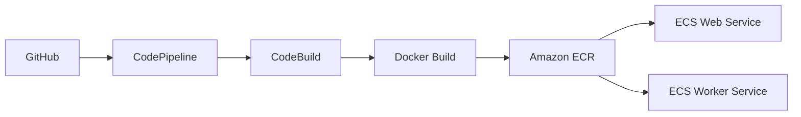

Every source code update triggers the automated pipeline, which builds the application containers, publishes images to ECR and deploys the updated services to ECS.

## 4. Technology Stack

- **Cloud:** AWS
- **Infrastructure as Code:** AWS CDK (TypeScript)
- **Application:** Node.js 22
- **Containers:** Docker
- **Orchestration:** Amazon ECS Fargate
- **Database:** Amazon RDS PostgreSQL
- **Caching:** Amazon ElastiCache Redis
- **Messaging:** Amazon SQS
- **Registry:** Amazon ECR
- **CI/CD:** AWS CodePipeline and CodeBuild
- **Monitoring:** Amazon CloudWatch
- **Disaster Recovery:** AWS Backup, Route 53 and S3

## 5. Repository Structure

```text
resilient-commerce-platform/
├── app/
│   ├── web/
│   └── worker/
├── infrastructure/
│   ├── bin/
│   └── lib/
├── pipeline/
├── evidence/
├── docs/
│   ├── architecture/
│   ├── operations/
├── scripts/
├── tests/
└── README.md
```

## 6. Deployment Status

| Component | Implementation Status |
|---|---|
| AWS CDK infrastructure | Deployed |
| ECS cluster | Deployed |
| Web service | 2/2 tasks running |
| Worker service | 1/1 tasks running |
| Amazon ECR | Configured |
| CodePipeline | Successful execution |
| S3 continuity website | HTTP 200 verified |
| Autoscaling under load | Testing/evidence pending |
| Route 53 failover | Testing/evidence pending |
| AWS Backup restoration | Testing/evidence pending |

*Operational testing status should be updated as additional verification is completed.*


## 7. Technical Documentation

Detailed technical documentation and operational procedures:

- [Architecture Documentation](docs/architecture/architecture.md)
- [Disaster Recovery Runbook](docs/operations/disaster-recovery-runbook.md)

## 8. Project Outcome

This project demonstrates practical cloud engineering capabilities in:

- Highly available AWS infrastructure.
- Container orchestration using ECS Fargate.
- Independent web and worker scaling.
- Asynchronous processing with SQS.
- Database protection and caching.
- Infrastructure automation using AWS CDK.
- Automated container builds and deployments.
- Monitoring, backup and disaster recovery.

---

## 9. Implementation Evidence

Screenshots demonstrating successful implementation are maintained in `evidence/`.

| Evidence | Screenshot |
|---|---|

Actual architecture diagram

## 9. Screenshots

The `evidence/` directory contains evidence of the implementation

---

**Architecture:** Architecture of the Project.

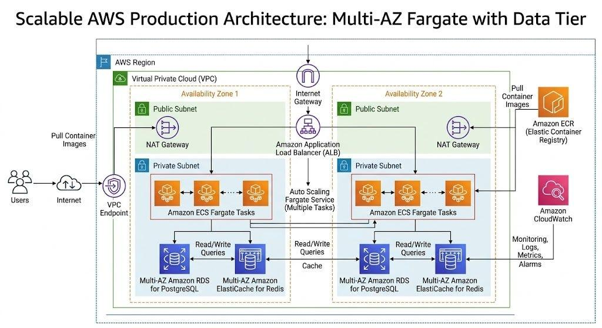

---

**VPC:**  VPC and Availability Zones.

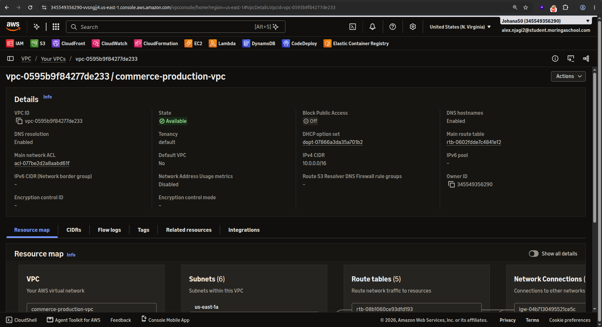

---

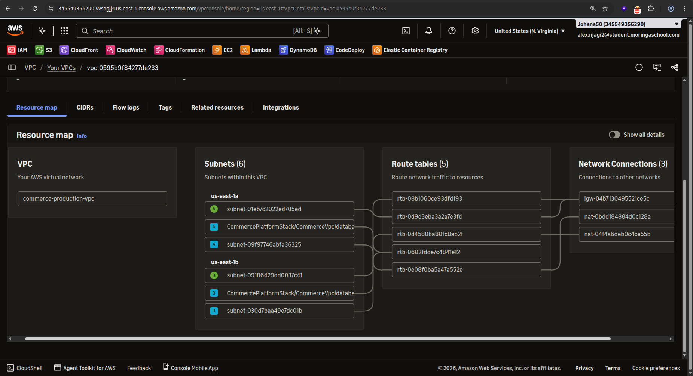

---

**ECS cluster** ECS cluster.

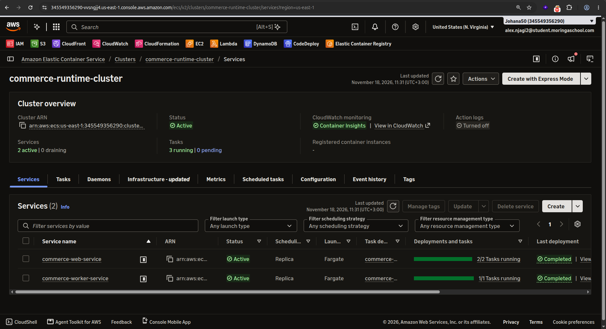

---

**Web service** Web service.

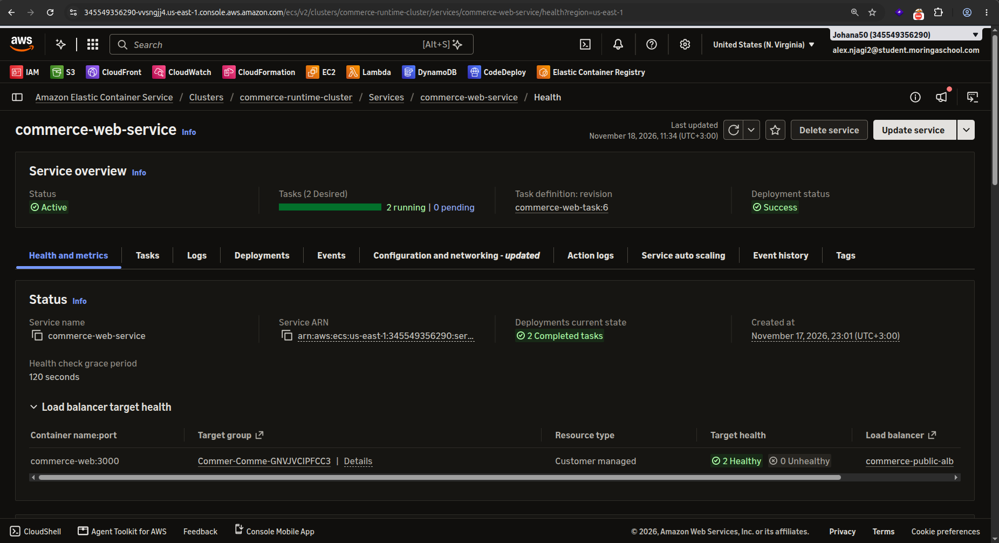

---

**Web Worker** Web Worker.

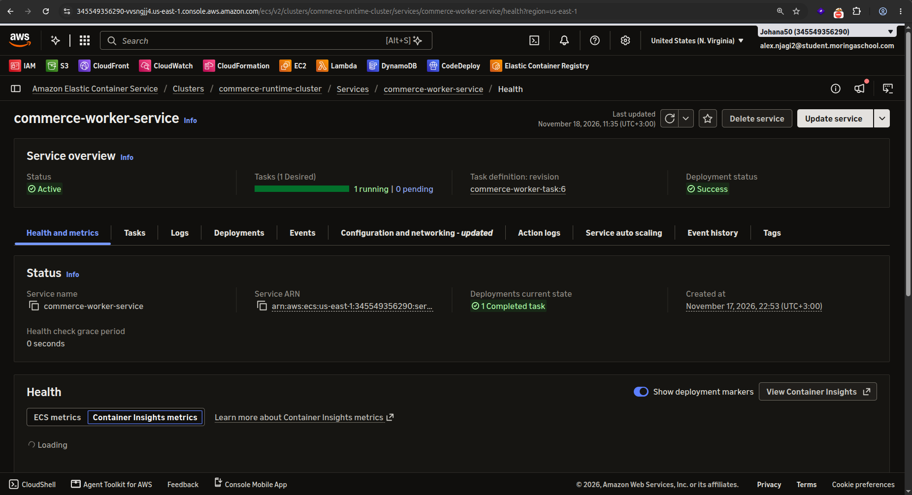

---

**RDS Multi-AZ configuration** RDS Multi-AZ configuration.

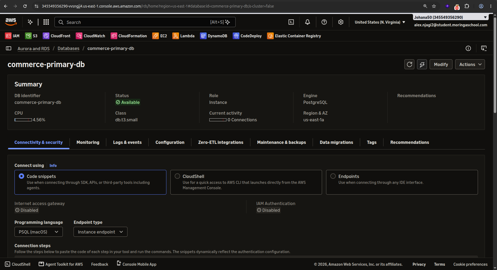

---

**Redis configuration** 	Redis configuration.

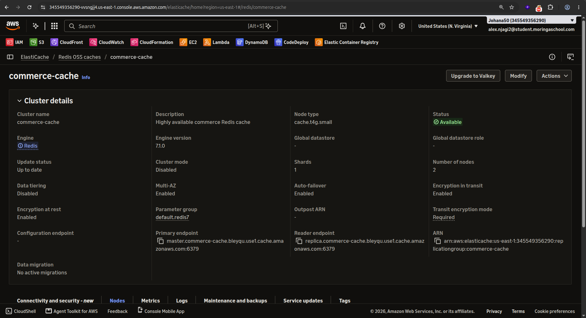

---

**SQS queue and DLQ**  SQS queue and DLQ.

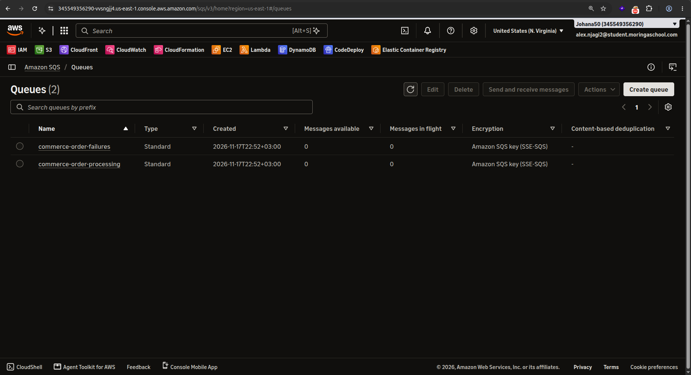

---

**Healthy ALB targets**  Healthy ALB targets.

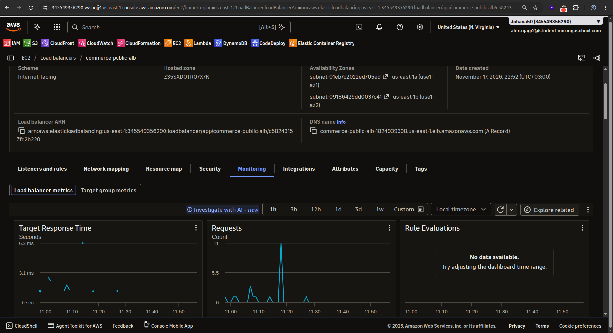

---

**Completed recovery point**  Completed recovery point.

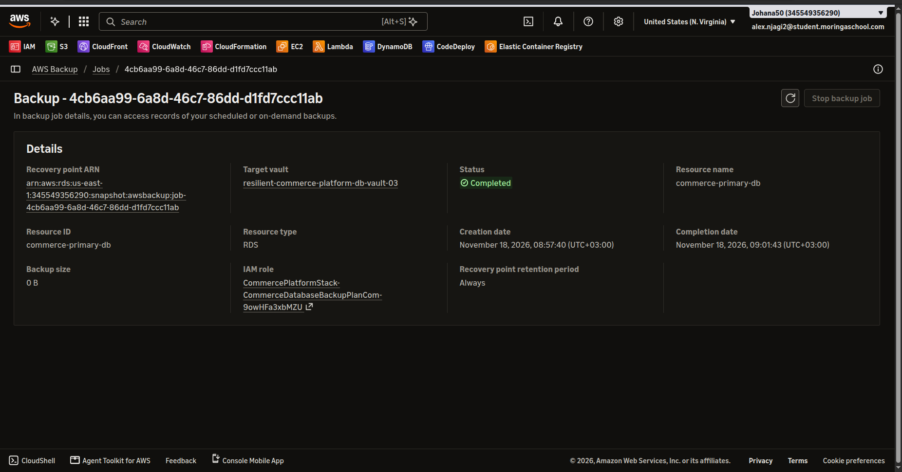

---

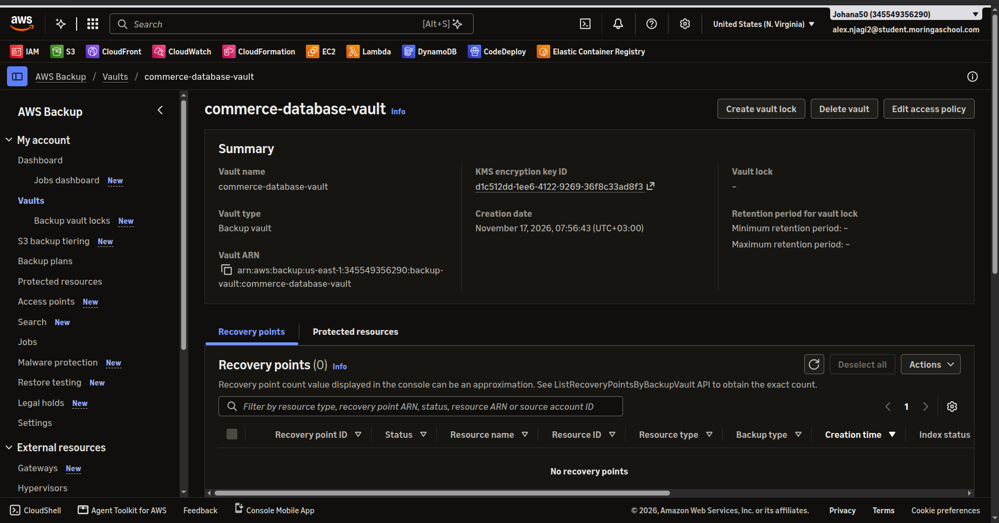

---

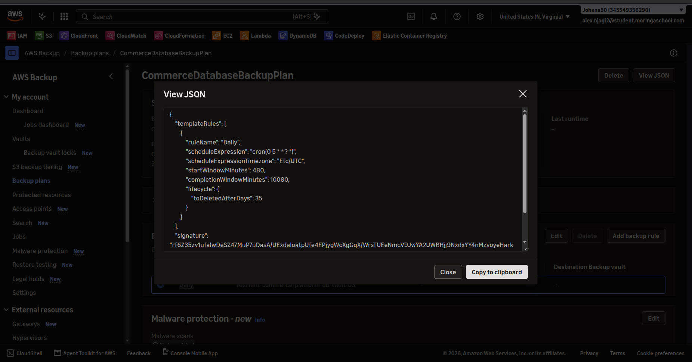

---

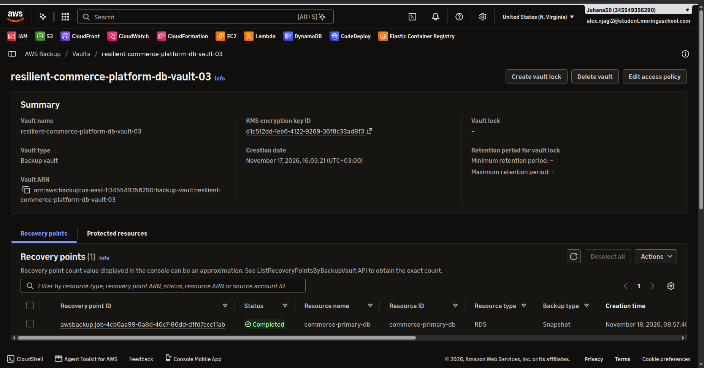

---

**Tested DNS failover**  Tested DNS failover(ROUTE53).

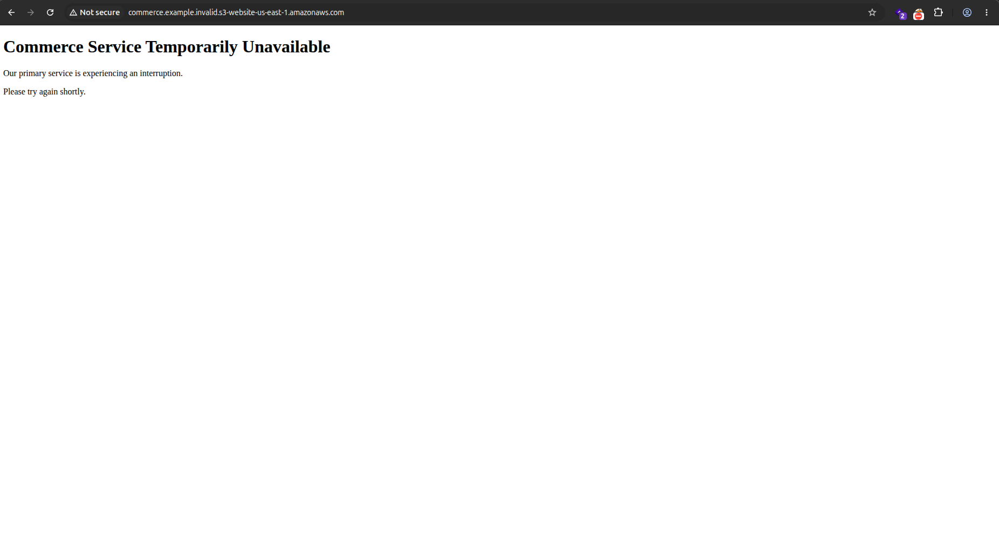

---

**Successful pipeline execution**  Successful pipeline execution

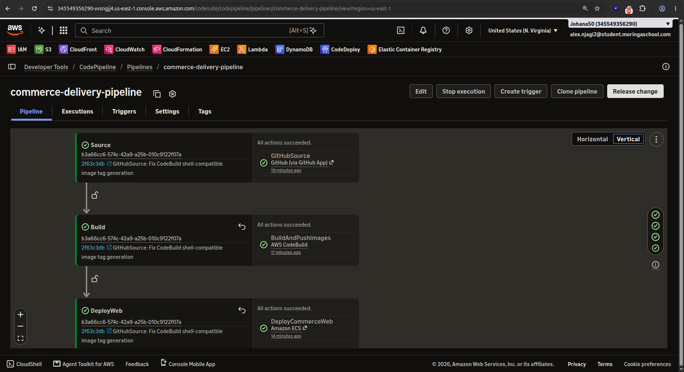

---

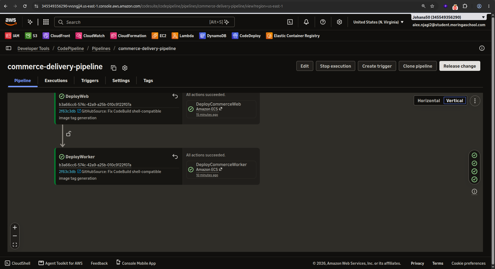

---
